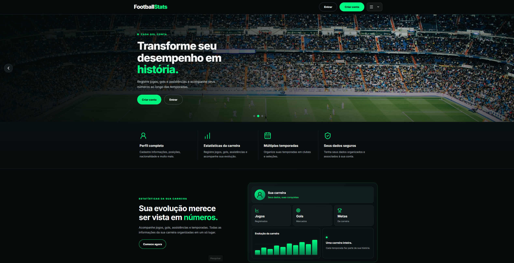

# ⚽ FootballStats

**Plataforma web para gerenciamento de carreiras, temporadas e estatísticas do futebol.**

O FootballStats é uma aplicação desenvolvida com React e Firebase para registrar e acompanhar a trajetória de jogadores e treinadores, organizando temporadas, estatísticas e conquistas em uma interface moderna e responsiva.

🌐 **Aplicação online:** https://football-stats-fdff1.web.app/

💻 **Repositório:** https://github.com/biondipedro388-lang/football-stats

## ✨ Funcionalidades

- 🔐 Autenticação de usuários e proteção de rotas.
- ⚽ Cadastro e gerenciamento de jogadores e treinadores.
- 👤 Perfis com informações e histórico de carreira.
- 📅 Organização e gerenciamento de temporadas.
- 📊 Registro e consolidação de estatísticas.
- 🏆 Registro de títulos por clubes e seleções, além de prêmios individuais e artilharias.
- 📱 Interface responsiva com tema escuro.

## 🖥️ Tecnologias utilizadas

- **React** — construção da interface.
- **Vite** — ambiente de desenvolvimento e build.
- **JavaScript** — lógica da aplicação.
- **Firebase Authentication** — autenticação de usuários.
- **Cloud Firestore** — banco de dados NoSQL.
- **React Router** — navegação entre páginas.
- **Lucide React** — ícones.
- **HTML e CSS** — estrutura e estilização.

## 🚀 Como executar localmente

### Pré-requisitos

- Node.js e npm instalados.
- Um projeto Firebase configurado com os serviços necessários.

### Instalação

```bash
git clone https://github.com/biondipedro388-lang/football-stats.git
cd football-stats
npm install
```

Configure o Firebase conforme as variáveis esperadas pelo arquivo `src/services/firebase`. Utilize suas próprias configurações locais e não publique arquivos com credenciais privadas.

Inicie o ambiente de desenvolvimento:

```bash
npm run dev
```

Para gerar a versão de produção:

```bash
npm run build
```

Para executar o lint, caso o script esteja configurado no projeto:

```bash
npm run lint
```

## 🎯 Objetivo

O FootballStats é um projeto prático de desenvolvimento web criado para aplicar conhecimentos de React, autenticação, banco de dados, navegação entre páginas e organização de aplicações.

## 📌 Status do projeto

**Em desenvolvimento.** Novas funcionalidades e melhorias podem ser incorporadas ao longo da evolução do projeto.

---

## 📸 Prévia do projeto



Desenvolvido por [Pedro Biondi](https://github.com/biondipedro388-lang).
